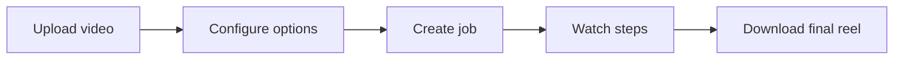

# PRD: Frontend for Vid-Process

**Product:** Short-form reel studio UI for the existing `vid-process` backend  
**Status:** Draft  
**Audience:** Product + engineering  
**Backend today:** Express API + BullMQ workers (no product UI; Bull Board only)  
**Backend as-built PRD:** [PRD.md](./PRD.md)

---

## 1. Problem

The backend already turns a talking-head clip into a vertical (9:16) reel with captions, AI-picked B-roll, crop/pad, and layout. Usage today is raw API calls (presign → PUT → create job → poll). There is no way for a non-API user to upload, configure, watch progress, or download the result.

## 2. Goal

Ship a web app where a user can:

1. Upload a video  
2. Set crop, layout, and subtitle style  
3. Start a job and see pipeline progress  
4. Preview intermediates when available  
5. Download the final reel when complete  

**Success (MVP):** A user can go from empty state → finished MP4 in under ~5 minutes of UI time (excluding processing), without using curl or Bull Board.

---

## 3. Users & jobs-to-be-done

| Persona | JTBD |
|--------|------|
| Creator / marketer | “Turn my talking-head take into an Instagram/TikTok-ready reel with captions + B-roll.” |
| Internal operator | “Debug a failed job: which step failed, what error, which artifacts exist?” |
| Integrator (later) | “Embed this flow in another product via webhook + APIs.” |

---

## 4. Scope

### In scope (MVP)

- Single-page (or 2–3 page) app against existing `/api`  
- Direct-to-MinIO upload via presigned URL  
- Create job with current knobs  
- Job detail: status, step timeline, errors, download links  
- Polling for live updates  
- Basic empty / loading / error / completed states  

### Out of scope (MVP)

- Auth, multi-tenant accounts, billing  
- Job list/search (no list API yet)  
- Cancel / retry / re-render with new settings  
- In-browser video editor / timeline scrubbing of B-roll  
- Real-time websockets (polling is enough)  
- Mobile native apps  
- Editing transcript / hotkeys before render  

### Nice-to-have (v1.1+)

- Job history (needs `GET /api/jobs`)  
- Live subtitle style preview (mock ASS overlay on video)  
- Webhook delivery status UI  
- Retry failed jobs / re-run from step  
- Transcript + B-roll manifest review/edit before render  
- Shareable result links with longer TTL  

---

## 5. Product principles

- **One primary action:** Upload → Configure → Create reel.  
- **Pipeline clarity:** Show the real stages (transcribe → keywords → B-roll → crop → render), not a fake spinner.  
- **Honest constraints:** Reflect what the API can do; don’t invent list/cancel until backend supports them.  
- **Vertical-first:** Previews and layout choosers should be 9:16-native.

---

## 6. User flows

### 6.1 Happy path



1. User selects a local video (mp4/webm/mov as backend allows).  
2. App calls `POST /api/upload/presigned-upload` with `{ fileName, contentType }`.  
3. App `PUT`s the file to `uploadUrl`.  
4. User sets crop, pad (if pad), layout, subtitle style (optional webhook).  
5. App calls `POST /api/jobs` with `objectName` + options.  
6. App navigates to `/jobs/:id` and polls `GET /api/jobs/:id` every 2–3s.  
7. When `status === "completed"`, show player + download using `finalVideoUrl`.  

### 6.2 Failure path

- Upload PUT fails → retry upload, don’t create job.  
- Create job 400 → show field errors from Zod `errors`.  
- Create job 503 → job exists but failed to queue; show `jobId` + failed state.  
- Job `failed` → highlight `currentStep` + the matching `*Error` field; offer “Start over” (new upload).  

### 6.3 Deep link

- `/jobs/:id` loads job details if the user bookmarks or refreshes.  
- No list: home is “new job”; job URL is the only history unless localStorage stores recent IDs.

---

## 7. Screens & requirements

### 7.1 Home / New job

**Must**

- File picker + drag-drop  
- Upload progress (browser XHR/fetch progress on PUT)  
- Form fields mapped to API:

| UI control | API field | Notes |
|------------|-----------|--------|
| Crop mode | `cropStrategy` | `center` \| `pad` |
| Pad fill | `padBackground` | Only if `pad`: `black` \| `white` \| `blur` |
| B-roll layout | `layout` | `top-half-overlay` \| `half-and-half` (+ short visual explanation) |
| Font size | `subtitleFontSize` | 24–96 |
| Vertical margin | `subtitleMarginV` | 0–800 |
| Side margins | `subtitleMarginL/R` | 0–400 |
| Font name | `subtitleFontName` | text, max 64 |
| Webhook URL | `webhookUrl` | optional absolute URL |

- Primary CTA: **Create reel** (disabled until upload succeeds and `objectName` exists)  
- Show selected file name, size, duration if probeable in-browser  

**Should**

- Sensible defaults matching backend (`center`, font 48, margins from schema defaults)  
- Layout cards with simple diagrams (top overlay vs half/half)  
- Local “recent jobs” from `localStorage` (id + createdAt + status cache)

**Must not (MVP)**

- Require auth  
- Promise cancel/retry  

### 7.2 Job detail / Progress

**Must**

- Overall status badge: `queued` | `processing` | `completed` | `failed`  
- Step list with per-step status:

  1. Transcription (`transcriptionStatus` / `transcriptionError`)  
  2. Keyword extraction (`keywordExtractionStatus` / `keywordExtractionError`)  
  3. B-roll (`brollStatus` / `brollError`)  
  4. Crop (`cropStatus` / `cropError`)  
  5. Render (inferred: overall still processing after crop+broll complete, or `layoutVideoKey` / `finalVideoKey` appearing)

- `currentStep` callout when processing/failed  
- When completed: embedded `<video>` for `finalVideoUrl` + Download button  
- When available, links for artifacts (1h TTL — label “expires in ~1 hour”):

  - Transcript (text/json), SRT/VTT  
  - Cropped, layout composite, final  

**Should**

- Auto-stop polling on `completed` / `failed`  
- Soft progress estimate (e.g. N/5 steps done) — not fake %  
- Copy job ID  

### 7.3 Empty / system states

- API health optional banner via `GET /api/health` if Redis/MinIO/Postgres down  
- Expired artifact URLs: friendly refresh (re-fetch job details for new presigns)

---

## 8. Information architecture

| Route | Purpose |
|-------|---------|
| `/` | Upload + configure + create |
| `/jobs/:id` | Progress + result |
| (optional) `/ops` | Link out to Bull Board for operators |

No auth routes in MVP.

---

## 9. Frontend ↔ backend contract

### APIs used

| Method | Path | Use |
|--------|------|-----|
| `POST` | `/api/upload/presigned-upload` | Get upload URL |
| `PUT` | MinIO `uploadUrl` | Binary upload |
| `POST` | `/api/jobs` | Start pipeline |
| `GET` | `/api/jobs/:id` | Poll status + artifacts |
| `GET` | `/api/health` | Optional status banner |

### Create job body (source of truth)

```ts
{
  objectName: string;
  cropStrategy?: "center" | "pad";
  padBackground?: "black" | "white" | "blur";
  subtitleFontSize?: number;   // 24–96
  subtitleMarginV?: number;    // 0–800
  subtitleMarginL?: number;    // 0–400
  subtitleMarginR?: number;    // 0–400
  subtitleFontName?: string;
  webhookUrl?: string;
  layout?: "top-half-overlay" | "half-and-half";
}
```

### Polling strategy

- Interval: 2s while `queued`/`processing`  
- Backoff to 5s after 2 minutes  
- Cap: stop after N minutes with “still running — refresh”  
- Prefer `finalVideoUrl` when `status === "completed"` over raw keys  

### Backend gaps the PRD must call out

| Gap | Frontend impact | Recommendation |
|-----|-----------------|----------------|
| No CORS on Express | Browser app blocked | Enable `cors` (dependency already present) or same-origin proxy |
| No auth | Anyone with URL can hit API | Accept for local MVP; add API keys before public deploy |
| No job list | No history page | `localStorage` recent IDs; later `GET /api/jobs` |
| No cancel/retry | Stuck jobs stay stuck | Document; later endpoints |
| Render has no step fields | Harder progress UI | Infer from keys/status; later add `renderStatus` |
| Presigned URLs ~1h | Players die after TTL | Re-fetch job on 403 / timer |
| Upload `publicUrl` localhost-hardcoded | Don’t rely on it in UI | Use `objectName` + job artifacts only |

---

## 10. Suggested tech stack (frontend)

Not prescribed by the backend; recommended:

| Choice | Why |
|--------|-----|
| **Next.js or Vite + React** | Fast SPA/SSR; team familiarity |
| **TypeScript** | Match backend types |
| **TanStack Query** | Polling, cache, retry for job detail |
| **Zod** | Mirror `createJobBodySchema` on client |
| **shadcn/ui or similar** | Forms, badges, progress without inventing a design system |

Deploy: static/SPA behind same origin as API (proxy `/api` → backend) to avoid CORS pain in local/prod.

---

## 11. Non-functional requirements

| Area | Requirement |
|------|-------------|
| Upload | Support files up to a documented limit (e.g. 500MB — confirm with MinIO/nginx); show size validation client-side |
| Performance | Job page TTI under 2s; polling must not thrash API |
| Accessibility | Keyboard upload alternative; status not color-only |
| Privacy | No third-party analytics required for MVP; don’t log webhook secrets in UI |
| Browser | Latest Chrome/Safari/Firefox; mobile web usable but desktop-first |

---

## 12. UX copy / mental model

User-facing stage names (map from backend):

| Backend | UI label |
|---------|----------|
| transcription | Transcribing speech |
| keyword extraction | Finding B-roll moments |
| broll | Fetching stock clips |
| crop | Framing to 9:16 |
| render (inferred) | Composing layout & burning captions |

Errors: show the raw `*Error` string in a collapsible “Technical details” so operators can debug without leaving the UI.

---

## 13. Phased delivery

### Phase 0 — Backend readiness (1–2 days)

- Enable CORS (or reverse proxy)  
- Confirm upload content types and max size  
- Optional: add `renderStatus` for cleaner UI  
- Optional: `GET /api/jobs?limit=` for history  

### Phase 1 — MVP UI (1–2 weeks)

- Upload + create job form  
- Job detail with polling + step timeline  
- Final video player + download  
- Artifact links  
- Recent jobs in `localStorage`  

### Phase 2 — Operator polish

- Health banner  
- Better failure UX  
- Layout/crop visual explainers  
- Subtitle margin live preview (CSS mock)  

### Phase 3 — Productization

- Auth + multi-user  
- Job list/search  
- Cancel / retry  
- Transcript/manifest review before final render  
- Webhook configuration + delivery log  

---

## 14. Metrics

| Metric | Target (MVP) |
|--------|----------------|
| Upload success rate | ≥ 95% |
| Jobs created after successful upload | ≥ 90% |
| Time-to-first-status on job page | &lt; 3s |
| Users who reach download after create | Track; improve drop-off at failed steps |
| Polling load | &lt; 1 RPS/job average |

---

## 15. Open questions

1. Is this an **internal tool** (trusted network) or a **public product**? That decides auth timing.  
2. Should users **edit** captions/B-roll before burn-in, or is one-shot OK forever?  
3. Target clip length (e.g. ≤ 60s / ≤ 3 min)? Affects upload UX and expectations.  
4. Monorepo (`apps/web`) vs separate repo?  
5. Brand/name for the product (repo is still `my-backend-service`).  

---

## 16. Acceptance criteria (MVP)

- [ ] User can upload a video via UI without using MinIO console  
- [ ] User can set crop, layout, and subtitle options and create a job  
- [ ] Job page reflects step statuses updating until terminal state  
- [ ] On success, user can play and download the final reel  
- [ ] On failure, user sees which step failed and the error message  
- [ ] Refreshing `/jobs/:id` restores state  
- [ ] Works against local docker-compose + API + workers  

---

## 17. Summary recommendation

Build a **thin React client** that wraps the existing flow: **presign → upload → create → poll → download**, with a clear 5-stage progress UI and form knobs that already exist on `POST /api/jobs`. Treat CORS/proxy and optional job-list/render-status as the main backend follow-ups; don’t block MVP on auth or a full editor.
