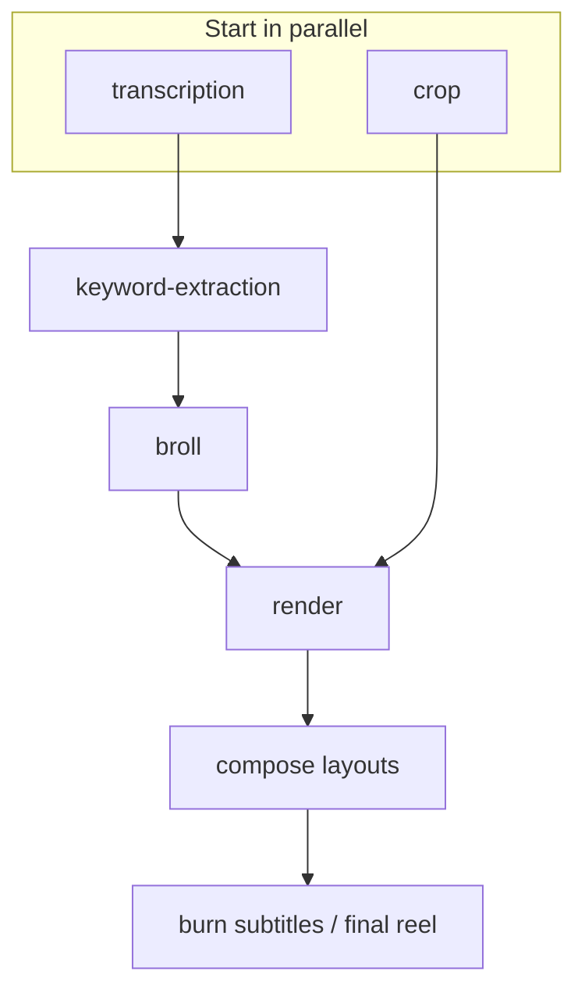

# PRD: Vid-Process Backend (As Built)

**Product:** `vid-process` — talking-head clip → vertical (9:16) reel pipeline  
**Status:** As built  
**Audience:** Product + engineering  
**Related:** Planned product UI is specified in [FRONTEND_PRD.md](./FRONTEND_PRD.md)

---

## 1. Overview

Vid-process is a Node/TypeScript backend that turns a talking-head source video into an Instagram/TikTok-ready **9:16 reel** with:

1. Speech transcription and short-form captions (SRT/VTT)
2. AI-selected B-roll moments (hot keys) from the transcript
3. Stock B-roll fetch (Pexels)
4. Vertical crop/pad of the primary video
5. Timed B-roll layout composition
6. Burned-in subtitles on the final MP4
7. Optional outbound completion/failure webhooks

There is **no product UI** in this repo. The operator surface is the HTTP API plus **Bull Board** (`/bull`). Clients integrate via presigned upload → create job → poll (and/or webhook).

**Stack:** Express, Prisma/Postgres, BullMQ/Redis, MinIO, FFmpeg/ffprobe (libass), OpenAI (Whisper + chat), Pexels.

---

## 2. Problem & goals

### Problem

Creators and integrators need a reliable way to produce short-form reels from raw talking-head footage without manually editing captions, finding B-roll, or framing for 9:16.

### Goals (delivered)

- Accept a raw video upload into object storage
- Run an asynchronous, observable multi-step pipeline
- Persist per-step status and artifact keys on a `Job` row
- Expose intermediates and a final reel via time-limited presigned URLs
- Notify an optional webhook when a job reaches a terminal state

### Success criteria

An integrator can: presign → PUT video → `POST /api/jobs` → poll `GET /api/jobs/:id` until `status === "completed"` → download `finalVideoUrl` (or receive `job.completed` webhook) without using Bull Board.

---

## 3. Users & jobs-to-be-done

| Persona | JTBD |
|--------|------|
| API integrator | “Upload a clip, configure crop/layout/subtitles, get a final reel URL or webhook.” |
| Internal operator | “See which queue/step failed, inspect Bull Board, fetch artifact keys from the job row.” |
| Future frontend user | Covered by [FRONTEND_PRD.md](./FRONTEND_PRD.md) — this backend is the contract that UI will call. |

---

## 4. Pipeline (as built)

Orchestration lives in `src/flows/video.flow.ts` (BullMQ parent/child flow). Transcription and crop start in parallel; render waits for both tracks, then composes layouts and burns subtitles.



| Stage | Queue | What it does | Job fields updated |
|--------|-------|--------------|-------------------|
| Create | API | Persist job + enqueue flow | Options + `status: queued` |
| Transcription | `transcription` | Extract audio → Whisper → transcript + SRT/VTT | `transcriptionStatus`, transcript/subtitle keys |
| Keywords | `keyword-extraction` | LLM B-roll manifest; optional job-wide layout override | `keywordExtractionStatus`, `brollManifestKey`, `brollLayout` |
| B-roll | `broll` | Resolve/download/fit Pexels clips | `brollStatus`, `brollResolvedKey` |
| Crop | `crop` | Fit primary to crop size (default 1080×1920) | `cropStatus`, `croppedVideoKey` |
| Render | `render` | Layout compose → subtitle burn | `layoutVideoKey`, `finalVideoKey`; overall `completed` / `failed` |
| Webhook | on terminal status | Best-effort POST | `webhookSentAt` |

**Overall status:** `queued` → `processing` → `completed` | `failed`.

**Per-step status:** `to_be_queued` → `queued` → `processing` → `completed` | `failed` (transcription, keywords, broll, crop). Render has no dedicated step status field; clients infer progress from `layoutVideoKey`, `finalVideoKey`, and overall `status`.

Workers run as **separate processes** (`worker:*` / `dev:all`). The API alone does not process jobs; Redis + workers are required.

---

## 5. Features (delivered)

### 5.1 Presigned upload + job create/get

- Client requests a MinIO PUT URL, uploads the raw file, then creates a job with the returned `objectName`.
- Done when: object lands in `raw-videos`, job row exists, flow is enqueued (or create returns 503 if enqueue fails after save).

### 5.2 Transcription + captions

- Whisper transcription; short-form SRT/VTT cues stored as intermediate assets.
- Done when: `transcriptionStatus === completed` and transcript/subtitle keys are set.

### 5.3 AI hot keys + Pexels B-roll

- LLM builds a B-roll manifest (search queries, timing, layout per segment).
- B-roll worker resolves clips within configured on-screen windows and concurrency limits.
- Done when: `brollStatus === completed` and `brollResolvedKey` is set (worker fails if zero clips resolve).

### 5.4 Vertical crop

- Strategies: `center` | `pad` (pad backgrounds: `black` | `white` | `blur`).
- Face-based crop was removed; not supported.
- Done when: `cropStatus === completed` and `croppedVideoKey` is set.

### 5.5 Layout composition + per-job layout override

- Modes: `top-half-overlay` | `half-and-half`.
- Optional create-job `layout` forces every B-roll segment’s layout (`brollLayout` on the job).
- Fade transitions use `LAYOUT_TRANSITION_MS` (default 250ms).
- Done when: `layoutVideoKey` points at the composited intermediate MP4.

### 5.6 Subtitle burn-in → final reel

- SRT → ASS with PlayRes matching crop dimensions; FFmpeg `subtitles` filter (libass) burns captions.
- Per-job style: font size, name, margins (L/R/V); defaults from env.
- Final object: `{jobId}/reel.mp4` in `final-videos`.
- Done when: `status === completed` and `finalVideoKey` / `finalVideoUrl` are available.

### 5.7 Outbound webhooks

- Per-job `webhookUrl`, else global `JOB_WEBHOOK_URL`.
- Events: `job.completed` | `job.failed`.
- Idempotent via `webhookSentAt`; best-effort (non-OK/timeout logged, not retried aggressively); never throws into the pipeline.
- Done when: successful delivery sets `webhookSentAt`, or no URL is configured (no-op).

### 5.8 Health + Bull Board

- `GET /api/health` checks Redis / MinIO / Postgres.
- `/bull` exposes queue UI for operators.

---

## 6. API contract

Base path: `/api`. No auth. CORS is not wired on Express today.

| Method | Path | Purpose |
|--------|------|---------|
| `POST` | `/api/upload/presigned-upload` | Presigned MinIO PUT for raw video |
| `POST` | `/api/jobs` | Create job + enqueue pipeline |
| `GET` | `/api/jobs/:id` | Job row + 1h presigned artifact URLs |
| `GET` | `/api/health` | Dependency health |
| `POST` | `/api/webhook` | Debug/echo inbound webhook receiver |
| — | `/bull/...` | Bull Board |

### 6.1 `POST /api/upload/presigned-upload`

**Body:** `{ fileName, contentType }`

**Response:** `{ uploadUrl, objectName, publicUrl }`

- PUT TTL: **10 minutes**
- Bucket: `raw-videos`
- `objectName` pattern: `videos/{uuid}-{fileName}`
- Do not rely on `publicUrl` (localhost-oriented)

### 6.2 `POST /api/jobs`

**Body:**

| Field | Type | Notes |
|-------|------|--------|
| `objectName` | string | Required; from upload |
| `cropStrategy` | `center` \| `pad` | Optional; else env default |
| `padBackground` | `black` \| `white` \| `blur` | Meaningful when pad |
| `subtitleFontSize` | int 24–96 | Optional |
| `subtitleMarginV` | int 0–800 | Optional |
| `subtitleMarginL` | int 0–400 | Optional |
| `subtitleMarginR` | int 0–400 | Optional |
| `subtitleFontName` | string ≤64 | Optional |
| `webhookUrl` | absolute URL | Optional per-job override |
| `layout` | `top-half-overlay` \| `half-and-half` | Optional job-wide B-roll layout |

**Responses:**

- **201** `{ jobData, objectName, message }`
- **400** Zod validation errors
- **503** Job saved but enqueue failed (`jobId`, `status: "failed"`)
- **500** Unexpected failure

### 6.3 `GET /api/jobs/:id`

Returns the full job row plus:

- `finalVideoUrl` — only when `status === "completed"` and final key exists
- `artifacts.*` — 1h presigned GETs: transcript JSON/text, SRT/VTT, audio, metadata, cropped, layout, final

**404** if job not found.

### 6.4 Outbound webhook payload

```json
{
  "event": "job.completed | job.failed",
  "jobId": "...",
  "status": "completed | failed",
  "objectName": "...",
  "currentStep": "...",
  "finalVideoKey": "...",
  "finalVideoUrl": "...",
  "layoutVideoKey": "...",
  "croppedVideoKey": "...",
  "brollResolvedKey": "...",
  "error": "string | null"
}
```

`finalVideoUrl` is set only on completed jobs. `error` is the first available step error on failure. Timeout: `JOB_WEBHOOK_TIMEOUT_MS` (default 5s).

---

## 7. Data model

Primary model: `Job` (`prisma/schema.prisma`).

| Area | Fields |
|------|--------|
| Identity | `id`, `objectName`, `status`, timestamps, `currentStep` |
| Transcription | transcript/subtitle keys, `transcriptionStatus` / `transcriptionError` |
| Keywords | `brollManifestKey`, keyword step status/error |
| B-roll | `brollStatus` / error / `brollResolvedKey` |
| Crop | status/error/`croppedVideoKey` / `cropStrategy` / `padBackground` |
| Layout | `layoutVideoKey`, `brollLayout` |
| Final | `finalVideoKey` + subtitle style columns |
| Webhook | `webhookUrl`, `webhookSentAt` |

### Storage buckets

| Bucket | Role |
|--------|------|
| `raw-videos` | Uploaded source |
| `intermediate-assets` | Audio, metadata, transcript, subtitles, crop, B-roll, layout |
| `final-videos` | `{jobId}/reel.mp4` |

---

## 8. Non-goals / known gaps

- Product UI (see [FRONTEND_PRD.md](./FRONTEND_PRD.md))
- Auth, multi-tenant accounts, billing
- `GET /api/jobs` list/search
- Cancel / retry / re-run from step
- Dedicated `renderStatus` field
- CORS middleware (needed for browser clients)
- Face crop strategy (removed)
- Guaranteed webhook delivery / retry queue (best-effort only)
- Editing transcript or B-roll manifest before render

---

## 9. Constraints

1. **Vertical-first:** Default frame `CROP_WIDTH` × `CROP_HEIGHT` (1080×1920).
2. **FFmpeg + libass:** Subtitle burn requires a binary with the `subtitles` filter; fonts must exist under `SUBTITLE_FONTS_DIR`.
3. **Parallel tracks:** Render waits for crop + broll children; layout prefers resolved B-roll (may continue primary-only with a warning if unresolved).
4. **Hot-key quotas:** Keyword step must return enough segments per duration (`MIN_REQUIRED_HOTKEYS` / `MAX_ALLOWED_HOTKEYS`).
5. **B-roll on-screen windows:** Clamped by `BROLL_MIN_ON_SCREEN_SEC` / `BROLL_MAX_ON_SCREEN_SEC` (defaults ~2.5–4s).
6. **Presigned TTL:** Artifacts ~**1 hour**; upload PUT ~**10 minutes**.
7. **Workers are separate processes** — API + Redis + worker fleet required for end-to-end processing.

---

## 10. Environment knobs

Validated in `src/config/env.ts`. Highlights:

| Area | Vars |
|------|------|
| Infra | `PORT`, `REDIS_*`, `DATABASE_URL`, `MINIO_*` |
| AI / B-roll | `OPEN_AI_API_KEY`, `MIN/MAX_*_HOTKEYS`, `PEXELS_*`, `BROLL_MIN/MAX_ON_SCREEN_SEC` |
| Crop | `CROP_WIDTH/HEIGHT`, `CROP_STRATEGY`, `CROP_PAD_BACKGROUND` |
| Layout | `LAYOUT_TRANSITION_MS` |
| Subtitles | `SUBTITLE_FONT_*`, margins, `SUBTITLE_FONTS_DIR` |
| Webhook | `JOB_WEBHOOK_URL`, `JOB_WEBHOOK_TIMEOUT_MS` |
| Binaries | `FFMPEG_PATH`, `FFPROBE_PATH` |

See `.env.example` for a minimal template. These are runtime defaults, not boolean feature flags.

---

## 11. Happy-path integrator flow

1. `POST /api/upload/presigned-upload` with `fileName` + `contentType`
2. `PUT` the file bytes to `uploadUrl`
3. `POST /api/jobs` with `objectName` and optional crop / layout / subtitle / webhook knobs
4. Poll `GET /api/jobs/:id` (or wait for webhook)
5. When `status === "completed"`, download via `finalVideoUrl` (re-fetch before TTL expiry)
